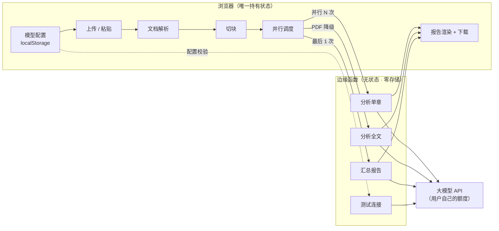
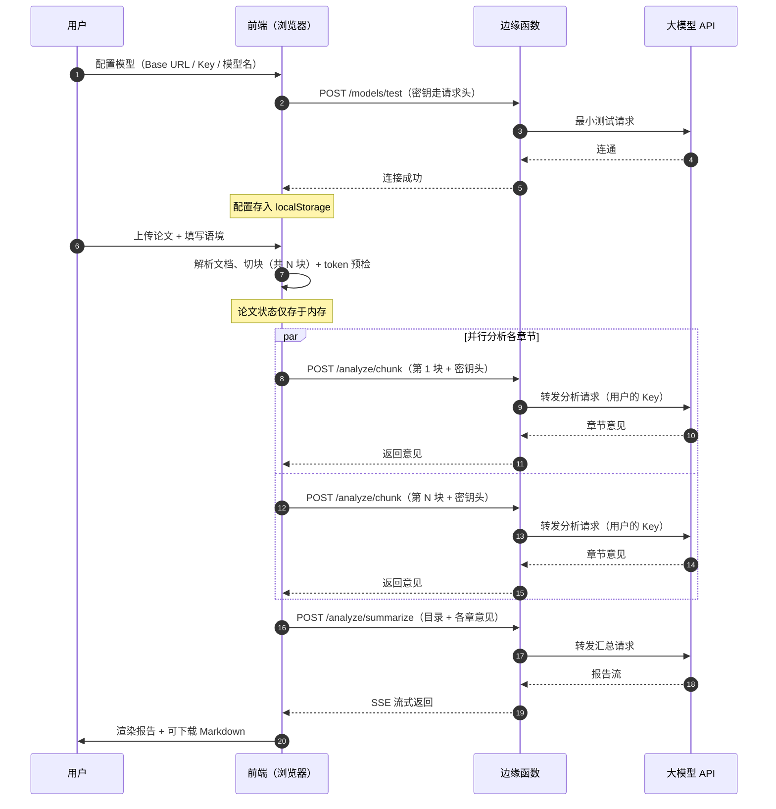

# 论文分析小助手 — 产品需求文档（PRD）

| 项目 | 内容 |
| --- | --- |
| 产品名称 | 论文分析小助手 |
| 文档版本 | v0.3 |
| 文档状态 | 待评审 |
| 创建日期 | 2026-10-29 |
| 产品形态 | Web 应用（浏览器使用） |
| 核心特征 | 无数据库、无用户体系、无历史记录、纯 BYOK |
| 作者 | tiandou250 |

### 变更记录

| 版本 | 日期 | 说明 |
| --- | --- | --- |
| v0.1 | 2026-10-29 | 首版。完成需求探索，确定无状态架构与分块评审方案 |
| v0.2 | 2026-10-29 | 确定产品名称；移除评分与等级机制、严重度分级、特别关注字段、批量评审；补充孟菲斯风格界面规范与作者卡片需求 |
| v0.3 | 2026-10-29 | 新增模型配置（BYOK）能力：用户自带 API Key 与模型，支持切换；补充密钥存储策略、测试连接、长上下文预检与安全声明 |

---

# 一、方案概述

## 1.1 一句话定义

上传一篇论文，用自己的大模型 API，返回一份结构化、锚定原文的 Markdown 分析报告。

## 1.2 背景与问题

论文作者在提交前普遍缺少一次"有结构的自检"。导师时间有限、同行不便打扰，而通用大模型对话式提问存在两个问题：

1. 需要用户自己会提问，不知道该从哪些维度检查；
2. 长论文超出上下文窗口，模型只读得到开头和结尾，中间章节的意见泛泛而谈。

本产品把"怎么问"和"怎么读长文"这两件事固化下来，用户只负责上传。

## 1.3 目标用户与场景

| 优先级 | 用户 | 场景 |
| --- | --- | --- |
| 主要 | 本科生、硕博研究生 | 论文初稿 / 终稿提交前自检 |
| 次要 | 期刊投稿作者 | 投稿前自查 |
| 次要 | 导师、教学秘书 | 快速初筛，定位问题论文 |

典型使用时机：写完一版稿子，想先自己过一遍问题清单，再交给导师。

## 1.4 核心价值主张

1. **意见有落点** — 每条问题锚定具体章节或原文，不产出"论证有待加强"这类空话。
2. **长文不漏读** — 按章节切块并行分析，10 万字论文的中间章节同样被认真读。
3. **数据不留痕** — 论文只在浏览器内存中处理，服务端零存储，页面关闭即释放。
4. **密钥归自己** — 用自己的 API Key 与额度，站方不接触、不承担模型成本。
5. **一份报告走天下** — 输出标准 Markdown，可下载、可粘贴、可版本管理。

## 1.5 需求边界

### 做

- 支持用户配置并切换自己的大模型 API（BYOK）
- 上传 Word / PDF / 粘贴纯文本
- 按章节分块并行分析
- 输出结构化 Markdown 报告
- 报告下载与复制
- 对报告内容追问（v1.1）

### 不做

- 不做用户注册、登录、账号体系
- 不做分析历史记录、不做云端保存
- 不做多人协作、不做分享链接
- 不做查重、不做格式自动校对
- **不做评分，也不做等级评定**（主观性强，容易引发争议）
- **不做问题严重度分级**（不区分"严重 / 中等 / 轻微"）
- **不做批量评审**（一次只处理一篇）
- **不提供站方默认模型密钥**（纯 BYOK，站方不承担任何模型成本，也不持有任何密钥）
- v0.1 不支持扫描件 PDF（无文字层）
- 不做公式与图表的语义理解

> 边界原则：**凡是需要"记住东西"的功能，一律不做。** 唯一例外是用户自己的模型配置，它只存在用户浏览器的 localStorage 里，与站方无关。

## 1.6 设计原则

| 编号 | 原则 | 含义 |
| --- | --- | --- |
| P1 | 服务端零存储 | 后端只是"文本进、意见出"的纯函数，不写任何数据 |
| P2 | 状态全在浏览器 | 论文、切块、意见、报告都只存在于前端内存 |
| P3 | 意见必须锚定原文 | 不允许无指向的评价，这是质量闸门 |
| P4 | 先跑通逻辑，后加复杂度 | v0.1 只做最小闭环，分块与解析逐步叠加 |
| P5 | 前端当调度员 | 多段调用由前端并行发起，避免服务端超时 |
| P6 | 只给判断，不给分数 | 用具体意见替代抽象打分 |
| P7 | 密钥归用户 | 用户自带 API Key，站方不持有、不代付、不记录 |

## 1.7 可行性结论

| 评估项 | 判断 | 说明 |
| --- | --- | --- |
| 架构可行性 | 通过 | 一次性任务，天然适配无状态服务，服务端无需存储 |
| 成本可行性 | 通过 | 站方零模型成本（纯 BYOK）；分块不增加总输入量 |
| 质量可行性 | 通过（有前提） | 取决于 prompt 设计；必须强制锚定原文 |
| 性能可行性 | 有条件通过 | 单篇总耗时约 1 分钟，需并行调用 + 进度提示 |
| 模型可切换 | 通过 | 仅支持 OpenAI 兼容格式，可填任意 Base URL |
| PDF 路径 | 降级通过 | 无结构文本无法精确切块，降级为整篇快速分析 |
| 扫描件 PDF | 不通过 | 无文字层，v0.1 明确不支持 |
| 理工科公式密集论文 | 部分通过 | 纯文本提取会破坏公式，分析质量打折，需在界面明示 |

**总体结论：方案成立。** 主要风险不在技术实现，而在"报告是否言之有物"，此风险由第 2.6 节的 Prompt 约束化解。

---

# 二、细节方案

## 2.1 端到端用户流程

```
1. 打开网页
2. 首次使用：配置模型 API（接口地址 / Key / 模型名）→ 点击测试连接
3. 上传论文（Word / PDF）或粘贴文本
4. 填写可选语境：论文类型 / 学科 / 当前阶段
5. 系统做 token 预检（窗口是否装得下）
6. 点击「开始分析」
7. 看到实时进度（解析中 → 分析 2/5 章 → 汇总中）
8. 页面流式输出 Markdown 报告
9. 下载 .md 文件 或 复制全文
10. （v1.1）针对某条意见继续追问
```

全程无注册、无登录。刷新页面清空论文与分析结果；**模型配置保留**（存在浏览器本地）。

## 2.2 功能模块拆解

| 模块 | 职责 | 优先级 |
| --- | --- | --- |
| M0 模型配置 | 管理用户自带 API Key、Base URL、模型名 | P0 |
| M1 输入模块 | 接收论文文本与上传文件，做基础校验 | P0 |
| M2 解析模块 | Word / PDF / 纯文本 → 带标题结构的文本 | P0 |
| M3 切块模块 | 按章节切分，控制单块体积 | P0 |
| M4 分析模块 | 调用模型产出章节意见 | P0 |
| M5 汇总模块 | 合并意见，生成最终报告 | P0 |
| M6 渲染与导出 | Markdown 渲染、下载、复制 | P0 |
| M7 进度反馈 | 分阶段进度与状态提示 | P0 |
| M8 追问模块 | 基于原文与报告继续问答 | P1 |

## 2.3 输入模块

| 输入方式 | 处理方式 | 结构保留 | 限制 |
| --- | --- | --- | --- |
| 粘贴纯文本 | 直接使用 | 无 | 用户需自行保证完整 |
| Word（.docx） | `mammoth.js` 浏览器端解析 | **保留标题层级（推荐主力）** | 不支持旧版 .doc |
| PDF | `pdf.js` 提取文本层 | 无 | 扫描件不支持；多栏排版可能错乱 |

### 交互要求

- 拖拽上传 + 点击选择 + 粘贴框三种方式并存，拖拽经过时整块高亮。
- 支持 `.docx` / `.pdf` / `.txt` / `.md`；旧版 `.doc` 提示另存为 `.docx`；单文件上限 30MB。
- 解析完成后展示文件名与「移除」按钮，解析结果自动填入正文输入框，用户可继续编辑。
- 上传后展示**字数统计**与**解析质量提示**：
  - 若 PDF 提取到的文本少于 500 字，判定为扫描件，提示"未检测到文字层，暂不支持扫描版 PDF"。
  - 若检测到 Word 结构，提示"已识别 N 个章节，将使用分章节深度分析"。
  - 若为 PDF 或无结构文本，提示"将使用整篇快速分析，建议上传 Word 获得更好的分章节意见"。
- **未配置模型 API 时给出醒目提示**，点击「开始分析」会直接打开配置面板。输入区不置灰，保留用户已粘贴的内容。

### 可选语境表单

| 字段 | 类型 | 选项 |
| --- | --- | --- |
| 论文类型 | 单选 | 本科毕业论文 / 硕士学位论文 / 博士学位论文 / 期刊投稿 / 其他 |
| 学科领域 | 文本 | 自由填写，如"教育技术学" |
| 当前阶段 | 单选 | 开题 / 初稿 / 修改稿 / 终稿 |

语境为可选项，不填也能分析，但填了会显著提升针对性。**不设"特别关注"字段**，保持表单轻量。

## 2.4 切块策略

### Word 路径（主路径）

1. 按 `Heading 1` 切分主章节。
2. 若某章超过 25000 字，继续按 `Heading 2` 二次切分。
3. 若单个二级小节仍超过 25000 字，按段落边界硬切，并在每块头部带上所属章节标题作为上下文。
4. 目标：**单块 15000 ~ 25000 字**，块数通常 3 ~ 8 块。

### PDF 路径（降级路径）

无层级信息，不做切块，直接整篇送审。若全文超过模型窗口上限，按字数硬切为若干等分块。

### 全局上下文提取

无论哪条路径，都要额外抽出一份**全局上下文**，供每个块共享：

- 论文题目（文件名或文档首行）
- 摘要（优先取"摘要"标题下的段落，取不到则取全文前 500 字）
- 目录（各章节标题列表）

## 2.5 分析维度

固定六个维度，避免模型自由发挥导致遗漏。**六个维度只用来组织意见，不产出分数或等级。**

| 维度 | 关注点 |
| --- | --- |
| 选题价值 | 研究问题的现实意义与学术价值，是否值得研究 |
| 文献综述 | 覆盖度、前沿性、是否有述无评、引用是否规范 |
| 研究方法 | 方法选择与问题的匹配度、可复现性、样本与数据可靠性 |
| 论证逻辑 | 论证链条是否完整、有无跳跃、结论是否被证据支撑 |
| 创新性 | 相对既有研究的增量，是观点新、方法新还是材料新 |
| 学术规范 | 引用格式、图表规范、术语一致性、语言表达 |

### 意见归属

- 前五个维度主要在**汇总阶段**做跨章节判断。
- 学术规范维度由各章节分析时局部记录，汇总时合并。

## 2.6 Prompt 设计

这是决定报告质量的核心。三条硬约束贯穿所有 prompt：

> **约束 A：每条意见必须锚定原文。** 引用具体句子或指明具体段落，禁止无指向的评价。
> **约束 B：允许说"没问题"。** 明确告知模型不要为了凑数编造意见。
> **约束 C：不给分数、不给等级、不分严重度。** 只描述问题本身和建议。

### 模板一：章节分析（M4）

```text
你是一位严谨的学术论文分析专家，正在分析一篇{{论文类型}}的其中一个章节。

【全局信息】
论文题目：{{题目}}
学科领域：{{学科}}
研究阶段：{{阶段}}
全文结构：
{{目录}}

【本次任务】
你收到的是全文中的「{{章节标题}}」。请**只针对这部分内容**给出分析意见。

【硬性要求】
1. 每条意见必须锚定你收到的原文——引用具体句子，或指出具体段落位置。
   禁止出现"论证有待加强""建议进一步完善"这类没有指向的表述。
2. 明确区分两类内容：
   - 事实性问题：数据错误、引用缺失、前后矛盾、方法描述不清
   - 改进建议：结构可优化、表达可精炼、补充材料可增强说服力
3. **不要给分数，不要给等级，不要标注问题严重程度。** 只描述问题本身和修改方向。
4. 如果这一部分确实没有明显问题，如实说明，不要凑数编造。
5. 不要写开场白，不要写总结语，直接输出正文。
6. 输出 Markdown，严格使用下方格式。

【输出格式】
### 本章问题
- 问题一句话概括
  - 位置：引用原文或指明段落
  - 问题：具体说明
  - 建议：可执行的修改方向

### 本章优点
- 一句话，锚定原文

### 学术规范记录
- 引用格式、图表、术语方面的问题（无则写"未见明显问题"）
```

### 模板二：报告汇总（M5）

```text
你是一位学术论文分析专家。以下是同一篇论文各章节的分析意见。

【论文信息】
题目：{{题目}}
类型：{{论文类型}}　学科：{{学科}}　阶段：{{阶段}}
结构：
{{目录}}
摘要：
{{摘要}}

【各章节分析意见】
{{chunkComments}}

【本次任务】
综合以上材料，产出一份完整的论文分析报告。

【硬性要求】
1. 跨章节的整体性判断（选题价值、创新性、逻辑自洽、工作量）只能基于上述材料推断。
   若信息不足，明确写"依据现有材料无法判断"，不得编造。
2. **不要给分数，不要给等级，不要标注严重程度。** 问题按重要性从高到低排列即可。
3. 主要问题最多列 10 条，每条必须能追溯到具体章节。
4. 引用原文时必须来自上述材料，不得虚构论文中没有的内容。
5. 不写客套话，不写"总的来说"。
6. 严格遵循下方模板输出，标题层级不得改动。

【输出模板】
（见 2.7 报告格式）
```

## 2.7 报告格式

固定 Markdown 模板，保证每次输出结构一致。**不含任何评分、等级或严重度标签。**

````markdown
# 论文分析报告

> **题目**：xxx
> **类型**：硕士学位论文
> **学科**：教育技术学
> **阶段**：初稿
> **分析模式**：分章节深度分析（共 5 章）
> **使用模型**：deepseek-chat
> **生成时间**：2026-10-29 15:30

## 一、总体评价

（150~250 字。说明整体水平、最突出的优点、最需要优先解决的问题。不许空泛。）

## 二、主要问题

### 1. 问题标题

- **位置**：第 3.2 节
- **原文**："……"
- **问题**：……
- **建议**：……

### 2. 问题标题

……

## 三、分章节意见

### 第 1 章 绪论

（该章分析意见）

### 第 2 章 文献综述

（该章分析意见）

## 四、修改建议清单

- [ ] ……
- [ ] ……
- [ ] ……

---

*本报告由 AI 生成，仅作为写作自检参考，不能替代导师或评审专家的专业意见。*
````

最后一行免责声明为**强制内容**：报告末尾必须保留，且页面底部固定展示（见 2.14）。

## 2.8 进度与反馈

长任务必须让用户知道系统在工作。

| 阶段 | 界面文案 | 说明 |
| --- | --- | --- |
| 预检 | 正在检查模型窗口… | token 估算 |
| 解析 | 正在解析文档… | 上传后立即出现 |
| 抽上下文 | 正在提取论文结构… | 快速 |
| 分块分析 | 正在分析第 2 / 5 章… | 每完成一块刷新计数 |
| 汇总 | 正在汇总生成报告… | 进入流式输出前的等待 |
| 输出 | 报告逐字出现 | SSE 流式渲染 |

要求：

- 章节分析进度必须以 `已完成 / 总数` 形式展示，并配进度条。
- 汇总阶段必须先出提示再流式输出，避免用户误以为卡死。
- 总耗时超过 30 秒时，追加文案"长论文分析需要约 1 分钟，请勿关闭页面"。

## 2.9 追问机制（v1.1）

用户看完报告后可能追问"第 3 条能展开说说吗"。因为不存记忆，实现方式为**每次追问重发上下文**：

```text
请求 = 论文全文 + 已生成报告 + 追问历史 + 当前问题
```

- 服务端依旧零存储，处理完即丢弃。
- 代价：每次追问都重发全文，token 消耗较高（消耗用户自己的额度）。
- 界面上明确提示："追问会重新提交论文全文，响应可能稍慢。"

## 2.10 导出

| 方式 | 实现 | 说明 |
| --- | --- | --- |
| 下载 .md | `Blob` + `a[download]` | 文件名 `论文分析报告-{论文标题}-{日期}.md` |
| 复制全文 | `navigator.clipboard` | 一键复制 Markdown 源码 |
| 页面渲染 | `markdown-it` + `DOMPurify` | 渲染为可读段落，防 XSS |

## 2.11 异常与边界处理

| 场景 | 处理 |
| --- | --- |
| 未配置模型 API | 页面醒目提示，点击开始分析时打开配置面板 |
| 密钥无效（401 / 403） | 提示"密钥无效或已过期"，一键跳转到设置面板 |
| 接口地址错误（404） | 提示"接口地址有误，请检查 Base URL" |
| 模型名称不存在 | 提示"模型名称不存在，请检查拼写" |
| 额度不足或限流（402 / 429） | 提示"账户额度不足或触发限流，请检查你的 API 账户" |
| 模型窗口不足 | 分析前拦截，提示更换模型或改用分块模式 |
| 文件为空 / 无文本 | 拦截并提示"未检测到文本内容" |
| 检测为扫描件 PDF | 提示不支持，建议改用 Word 或纯文本 |
| 文件超过 30MB | 拦截并提示换一个小一些的文件 |
| 旧版 .doc 格式 | 提示用 Word 另存为 .docx 后再上传 |
| 不支持的文件格式 | 提示仅支持 .docx / .pdf / .txt / .md |
| 文件解析过程出错 | 展示具体原因，不清空用户已有内容 |
| 文本过短（< 800 字） | 提示"内容过短，可能不是完整论文，是否继续" |
| 单块超过模型窗口 | 自动二次切分，并记录日志 |
| 请求失败 | 单块失败不阻塞整体，标记"该章分析失败"并继续 |
| 全部块失败 | 展示错误原因与重试按钮 |
| 模型输出格式错乱 | 汇总阶段做容错：缺失章节按空处理，不报错 |
| 用户中途关闭页面 | 无副作用（服务端不存任何东西） |

## 2.12 成本与性能指标

以一篇 10 万字硕博论文为例（模型成本由用户自行承担）：

| 指标 | 估算值 | 说明 |
| --- | --- | --- |
| 总输入 token | 约 15 ~ 20 万 | 分块后总量约等于全文，仅多出少量重复指令 |
| 调用次数 | 5 ~ 8 次 | N 块分析 + 1 次汇总 |
| 相对成本 | 整篇直评的 1.2 ~ 1.4 倍 | 分块不增加总输入量，仅增加指令重复与汇总开销 |
| 总耗时 | 约 50 ~ 90 秒 | 并行后 ≈ 最慢单块 + 汇总 |
| 报告长度 | 2000 ~ 4000 字 | 视论文问题多少浮动 |

**关键结论：分块牺牲的是调用次数与总耗时，不是金钱。站方的模型成本为零。**

## 2.13 埋点（v1.1，可选）

因不设账号，埋点仅做匿名聚合，用于验证产品质量：

- 上传方式分布（Word / PDF / 粘贴）
- 平均论文字数、平均块数
- 分析成功率、失败原因分布
- 报告下载率、追问率
- 各阶段平均耗时
- 用户所用模型分布（仅记录模型名称，不记录密钥）

不采集论文内容、不采集密钥、不采集任何可识别用户身份的信息。

## 2.14 界面与视觉规范

### 风格定位

整体采用**孟菲斯（Memphis）风格**。核心特征：粗黑描边、硬阴影、几何装饰、高饱和撞色、轻微不对称。

选择理由：孟菲斯自带设计感与 playful 气质，与"论文工具"的严肃印象形成反差，降低工具的距离感，也便于在社交渠道传播。

### 视觉要素

| 要素 | 规则 |
| --- | --- |
| 描边 | 主元素统一 3px 纯黑描边（`#111827`） |
| 阴影 | 硬阴影，无模糊：`4px 4px 0 #111827` |
| 圆角 | 小圆角 8px 或直角，不使用大圆角 |
| 装饰 | 圆点阵、三角、波浪线、锯齿，作为背景点缀，不干扰正文阅读 |
| 布局 | 主要内容居中，装饰元素允许轻微旋转（-6° ~ 6°） |
| 字体 | 中文黑体（思源黑体 / 系统字体），标题加粗 |

### 配色（取自 Tailwind 调色板）

| 用途 | 色值 | Tailwind |
| --- | --- | --- |
| 页面底色 | `#FFFBEB` | amber-50 |
| 主色（主要操作） | `#8B5CF6` | violet-500 |
| 强调色 1 | `#EC4899` | pink-500 |
| 强调色 2 | `#22D3EE` | cyan-400 |
| 强调色 3 | `#FBBF24` | amber-400 |
| 强调色 4 | `#34D399` | emerald-400 |
| 描边 / 主文字 | `#111827` | gray-900 |
| 次要文字 | `#6B7280` | gray-500 |
| 成功 / 错误 | `#10B981` / `#EF4444` | emerald-500 / red-500 |

规则：同一屏内撞色不超过 4 种；主色 violet-500 只用于主要操作，避免全屏花哨。

### 按钮与悬停动效

所有可点击元素必须有明确的悬停反馈。统一规则：

| 状态 | 表现 |
| --- | --- |
| 默认 | 3px 黑边 + `4px 4px 0` 硬阴影 |
| 悬停 | 元素上移 2px、左移 2px，阴影增大到 `6px 6px 0`；同时背景色加深一档（如 violet-500 → violet-600） |
| 按下 | 元素下移右移 2px，阴影收缩为 0，形成"按下去"的手感 |
| 过渡 | `transition: 150ms ease-out` |

卡片类元素悬停时可增加轻微旋转（`rotate(1deg)`）增强俏皮感。

禁用状态：降低不透明度、去掉阴影、鼠标 `not-allowed`。

### 页面浮层布局

| 位置 | 元素 |
| --- | --- |
| 左上角 | 作者卡片：默认「论文分析小助手」，点击切换「tiandou250 制作」 |
| 右上角 | 模型配置入口：圆形齿轮按钮，孟菲斯风格，悬停同上 |
| 角标 | 当前生效的模型名称（如 `deepseek-chat`），点击可直接打开设置面板 |

### 作者卡片

| 项 | 规则 |
| --- | --- |
| 位置 | 页面左上角固定悬浮 |
| 默认内容 | 显示「论文分析小助手」 |
| 点击行为 | 切换显示「tiandou250 制作」，再次点击收起 |
| 样式 | 孟菲斯风格徽章：amber-400 底色 + 3px 黑描边 + 硬阴影 |
| 层级 | 始终位于内容之上，但不遮挡主要操作区 |

### 底部免责声明

报告页底部**固定显示**一行免责声明，滚动时保持可见：

> 本报告由 AI 生成，仅作为写作自检参考，不能替代导师或评审专家的专业意见。

导出为 .md 时，该声明同样保留在文件末尾。

### 可访问性

- 所有悬停效果必须同时提供 focus 态，保证键盘 Tab 可达。
- 正文文字与底色对比度不低于 4.5:1。
- 动效遵循 `prefers-reduced-motion`，用户关闭动效时禁用位移动画。

## 2.15 模型配置（BYOK）

本产品采用 **BYOK（Bring Your Own Key）** 模式：用户填入自己的大模型 API 信息。**站方不提供默认密钥，不持有任何密钥，也不承担 token 成本。**

### 设置面板

| 字段 | 类型 | 说明 |
| --- | --- | --- |
| 接口地址（Base URL） | 文本 | 默认 `https://api.openai.com/v1`，可改为任意 OpenAI 兼容地址 |
| API Key | 密码框 | 支持切换明文查看 |
| 模型名称 | 文本 | 手动输入，如 `gpt-4o`、`deepseek-chat`、`moonshot-v1-128k` |
| 测试连接 | 按钮 | 发送一次最小请求验证配置是否可用 |
| 清除配置 | 按钮 | 一键删除本地保存的密钥与配置 |

入口位于页面右上角，与左上角作者卡片对称。页面角标显示当前生效的模型名称。

### 密钥存储

- 密钥保存在浏览器 `localStorage`，**不经服务端存储**。
- 刷新页面后配置仍然有效，无需重新填写。
- 提供「清除配置」按钮，用户可随时删除本地密钥。
- 服务端仅在请求生命周期内使用密钥完成转发，**不记录、不落盘、不写入任何日志**。

### 安全声明（界面原文，必须完整展示）

> 密钥只保存在你的浏览器里。分析时它会随请求经过我们的服务器完成转发，我们不记录、不落盘、不做任何留存。

**这段话必须如实呈现，不得简化为"密钥不会上传"** —— 因为转发链路客观存在。

### 兼容范围

v1 仅支持 **OpenAI 兼容格式**（`POST {BaseURL}/chat/completions`）。该格式已是事实标准，覆盖：

- DeepSeek（`https://api.deepseek.com/v1`）
- Kimi / Moonshot（`https://api.moonshot.cn/v1`）
- 通义千问（DashScope 兼容模式）
- 豆包（火山方舟兼容模式）
- 智谱 GLM、硅基流动 等

Anthropic、Gemini 等非兼容格式在 v1 **不支持**，后续按需扩展。

### 测试连接

点击后向目标地址发送一次最小请求（约 10 token），根据结果给出明确反馈：

| 结果 | 提示文案 |
| --- | --- |
| 成功 | 连接成功，当前模型可用 |
| 401 / 403 | 密钥无效或已过期 |
| 404 | 接口地址错误，请检查 Base URL |
| 模型不存在 | 模型名称不存在，请检查拼写 |
| 402 / 429 | 账户额度不足或触发限流 |
| 超时 | 连接超时，请检查网络或接口地址 |

这一步不可省略 —— 缺少它，用户填错配置后只会看到莫名其妙的失败，无法定位问题。

### 长上下文预检

分析开始前必须做一次 token 估算与拦截：

1. 按字符类型分别估算：中日韩字符约 1.5 token/字，其他字符约 0.35 token/字，两者相加。
2. 与用户配置的模型窗口上限比较（窗口上限由用户填写，或在常用模型表中查表）。
3. 若预计超出，**阻止分析**并提示：

> 当前模型上下文窗口不足。这篇论文约需 18 万 token，请更换更大窗口的模型，或改用分块模式。

4. 若未超出但接近上限（占用 > 80%），给出提示但仍允许继续。

同样不可省略 —— 缺少它，用户会把"模型装不下"误判为产品故障。

### 配置切换

- 用户可随时修改并切换模型，配置即时生效。
- 切换模型后**无需重新上传论文**。
- 每份报告的头部会记录生成时所用的模型名称，便于追溯。

---

# 三、技术架构

## 3.1 架构总览

核心思想：**浏览器是唯一持有状态的地方，服务端是无状态的纯函数。密钥由用户自带，仅经过服务端转发。**



三层职责：

| 层 | 职责 | 状态 |
| --- | --- | --- |
| 浏览器 | 保存用户配置、解析、切块、调度、渲染、导出 | 持有全部状态（含密钥） |
| 边缘函数 | 收文本 + 收密钥 → 转发模型 → 返回意见 | 零状态，不落盘 |
| 大模型 API | 推理 | 由用户配置，消耗用户额度 |

## 3.2 前端架构

| 关注点 | 方案 | 说明 |
| --- | --- | --- |
| 框架 | Vue 3 + Vite + TypeScript | 沿用现有技术栈 |
| 状态管理 | `ref` / `reactive` | 单页面流程，无需 Pinia |
| 持久化 | **仅模型配置**（localStorage） | 论文与分析结果不持久化，刷新即清空 |
| 样式 | 原生 CSS（或 Tailwind CSS） | 孟菲斯风格实现，规范见 2.14 |
| 核心模块 | `parser` / `chunker` / `scheduler` / `renderer` / `llmConfig` | 见下方模块划分 |

### 前端模块划分

```
src/
├─ modules/
│  ├─ llmConfig/
│  │   ├─ store.ts       # localStorage 读写密钥与模型配置
│  │   ├─ presets.ts     # 常用模型窗口表（用于 token 预检）
│  │   └─ precheck.ts    # token 估算与窗口校验
│  ├─ parser/
│  │   ├─ docx.ts        # mammoth.js 解析 Word
│  │   ├─ pdf.ts         # pdf.js 提取文本层
│  │   └─ detect.ts      # 输入类型识别 + 扫描件判定
│  ├─ chunker/
│  │   ├─ byHeading.ts   # 按标题层级切块
│  │   └─ fallback.ts    # 无结构文本按长度切
│  ├─ scheduler/
│  │   └─ review.ts      # 并行调度 N+1 次调用 + 进度上报
│  ├─ renderer/
│  │   └─ markdown.ts    # markdown-it + DOMPurify
│  └─ export/
│      └─ download.ts    # Blob 下载 .md
├─ api/
│  └─ client.ts          # 调用边缘函数，注入密钥请求头，处理 SSE
├─ styles/
│  └─ memphis.css        # 孟菲斯风格变量与组件样式
└─ components/
    ├─ BrandCard.vue     # 左上角作者卡片
    ├─ ModelSettings.vue # 右上角模型配置面板
    ├─ UploadPanel.vue
    ├─ ContextForm.vue
    ├─ ProgressBar.vue
    ├─ ReportView.vue
    └─ DisclaimerBar.vue # 底部固定免责声明
```

**关键点：`scheduler` 是前端的核心。** 它负责并发发起 N 个章节分析请求、收集结果、再发起汇总请求。后端不承担编排职责。

## 3.3 后端架构

后端只暴露四个无状态接口，每个接口做一件事。

| 接口 | 职责 | 输入 | 输出 |
| --- | --- | --- | --- |
| `POST /api/analyze/chunk` | 分析单个章节 | 单块文本 + 全局上下文 | 章节意见 Markdown |
| `POST /api/analyze/whole` | 整篇分析（PDF 降级 / 短论文） | 全文 + 全局上下文 | 报告 Markdown（流式） |
| `POST /api/analyze/summarize` | 汇总生成最终报告 | 目录 + 摘要 + 各章意见 | 报告 Markdown（流式） |
| `POST /api/models/test` | 测试用户模型配置 | Base URL + 模型名（密钥走请求头） | 连通性结果 |
| `POST /api/followup` | 追问（v1.1） | 全文 + 报告 + 问题 | 回答（流式） |

每个接口的执行逻辑完全一致：

```
1. 校验请求体（长度上限、字段完整性）
2. 从请求头取出用户配置（Base URL / Key / 模型名）
3. 组装 system prompt + user content
4. 以用户配置转发请求到大模型 API
5. 流式或一次性返回结果
6. 结束 —— 不做任何写入
```

**设计约束：**

- 后端不保存任何请求内容与密钥，不写日志到持久存储，日志需屏蔽 `X-LLM-Key` 请求头。
- **站方不配置任何模型密钥**，环境变量中不存在 `API_KEY` 之类的兜底。
- 单个请求处理时间控制在函数超时限制内（边缘函数通常 30 ~ 60 秒），因此严禁后端串行编排多次模型调用。
- **模型不绑定**：请求头中的 Base URL 与模型名决定实际调用谁。

## 3.4 核心数据流



**为什么用并行而不是串行：** 串行的总耗时是各块之和（10 万字可能 5 分钟以上）；并行后总耗时约等于最慢的那一块。

**为什么由前端发起并行：** 若由后端内部并发调用模型，单个请求会超过边缘函数超时限制。前端发起则每次请求都是短任务，天然规避超时。

## 3.5 接口定义

### 通用请求头（除测试接口外，所有模型相关接口必带）

| 请求头 | 说明 |
| --- | --- |
| `X-LLM-Base` | 用户配置的接口地址（Base URL） |
| `X-LLM-Key` | 用户 API Key |
| `X-LLM-Model` | 用户配置的模型名称 |

服务端读取这三项后即用于转发，**不写入日志、不持久化**。

### POST /api/models/test

请求头：`X-LLM-Key`

请求体：

```json
{
  "base": "https://api.deepseek.com/v1",
  "model": "deepseek-chat"
}
```

响应体：

```json
{
  "ok": true,
  "message": "连接成功，当前模型可用",
  "latencyMs": 842
}
```

### POST /api/analyze/chunk

请求头：`X-LLM-Base` / `X-LLM-Key` / `X-LLM-Model`

请求体：

```json
{
  "chunk": {
    "title": "第 3 章 研究方法",
    "text": "（该章节正文，15000~25000 字）"
  },
  "context": {
    "title": "基于 XX 的 XX 研究",
    "abstract": "（摘要文本）",
    "toc": ["第 1 章 绪论", "第 2 章 文献综述", "第 3 章 研究方法"],
    "type": "硕士学位论文",
    "discipline": "教育技术学",
    "stage": "初稿"
  }
}
```

响应体：

```json
{
  "title": "第 3 章 研究方法",
  "comment": "### 本章问题\n- 问题概括\n  - 位置：……\n  - 问题：……\n  - 建议：……"
}
```

### POST /api/analyze/whole

请求头：同上

请求体：

```json
{
  "text": "（全文，或经硬切后的一个分块）",
  "context": { "（同 chunk 接口的 context 结构）": "..." }
}
```

响应：`text/event-stream`，逐段返回 Markdown。

### POST /api/analyze/summarize

请求头：同上

请求体：

```json
{
  "context": {
    "title": "基于 XX 的 XX 研究",
    "abstract": "（摘要文本）",
    "toc": ["第 1 章 绪论", "第 2 章 文献综述"],
    "type": "硕士学位论文",
    "discipline": "教育技术学",
    "stage": "初稿"
  },
  "chunkComments": [
    { "title": "第 1 章 绪论", "comment": "（该章意见）" },
    { "title": "第 2 章 文献综述", "comment": "（该章意见）" }
  ],
  "failedChunks": []
}
```

响应：`text/event-stream`，流式返回最终报告 Markdown。

### 通用约定

- 所有接口均为 `POST`，`Content-Type: application/json`。
- 流式接口使用 SSE，事件格式 `data: {json}\n\n`，结束符 `data: [DONE]`。
- 统一错误结构：

```json
{
  "error": {
    "code": "INVALID_API_KEY",
    "message": "密钥无效或已过期"
  }
}
```

错误码约定：`INVALID_API_KEY` / `INVALID_BASE_URL` / `MODEL_NOT_FOUND` / `QUOTA_EXCEEDED` / `CONTEXT_TOO_LONG` / `TEXT_TOO_LONG`。

## 3.6 技术选型

| 层 | 选型 | 理由 |
| --- | --- | --- |
| 前端框架 | Vue 3 + Vite + TypeScript | 现有技术栈，上手快 |
| 样式方案 | 原生 CSS 变量（或 Tailwind CSS） | 便于实现孟菲斯风格的描边与硬阴影 |
| Word 解析 | `mammoth.js` | 纯浏览器端，保留标题层级 |
| PDF 解析 | `pdf.js` | 只取文本层，无服务端依赖 |
| Markdown 渲染 | `markdown-it` + `DOMPurify` | 渲染报告并防 XSS |
| 文件下载 | `Blob` + `a[download]` | 纯前端生成 .md |
| 配置存储 | `localStorage` | 仅存模型配置，不上云 |
| 后端运行时 | 边缘函数（EdgeOne Pages Functions / Vercel Edge） | 零运维、天然无状态、按量计费 |
| 大模型 | **OpenAI 兼容格式，由用户配置（BYOK）** | 站方零成本、零密钥持有 |
| 流式协议 | SSE | 打字机效果，实现简单 |
| 存储 | **无** | 不引入数据库、KV、对象存储 |

## 3.7 无状态与存储策略

**为什么不需要数据库？** 本产品是典型的"一次性任务型"应用：输入 → 处理 → 输出，三个阶段全部在一次会话内完成，不存在跨会话、跨用户、跨设备的数据。因此服务端不需要记住任何东西。

数据生命周期表：

| 数据 | 存放位置 | 生命周期 |
| --- | --- | --- |
| 论文原文 | 浏览器内存 | 页面关闭即释放 |
| 切块结果 | 浏览器内存 | 同上 |
| 各章节意见 | 浏览器内存 | 同上 |
| 最终报告 | 浏览器内存 | 同上 |
| **模型配置与密钥** | **浏览器 localStorage** | **用户主动清除前一直保留** |
| 服务端 | —— | **无任何写入** |

**关于密钥的特别说明：** 密钥是本产品唯一被持久化的数据，且只存在于用户自己的浏览器。它不进入服务端存储、不进入日志、不进入任何第三方。这是 BYOK 模式下的必要取舍 —— 否则用户每次刷新都要重填密钥，体验不可接受。

**未来若需扩展（提前预留）：** 若产品后续要加"历史记录"或"账号体系"，只需新增一个存储层并在前端替换 `scheduler` 的读写实现，业务逻辑与 prompt 无需改动。因此建议从一开始就把"结果持久化"抽象为一个空实现的接口，方便将来接入。

## 3.8 部署方案

- 单仓库同时部署前端静态产物与边缘函数。
- 静态资源走 CDN，函数就近执行。
- **无需配置任何模型密钥环境变量** —— 站方不持有密钥。
- 无需数据库实例、无需对象存储、无需额外的后端服务器。
- 成本结构：静态托管近乎免费，函数按调用量计费，模型费用由用户承担。

## 3.9 安全与限流

| 项 | 措施 |
| --- | --- |
| 密钥存放 | 仅存用户浏览器 `localStorage`，不上传至任何存储 |
| 密钥传输 | 随请求头经过边缘函数转发，函数不落盘、不写日志、内存中用完即弃 |
| 日志安全 | 日志中间件强制屏蔽 `X-LLM-Key` 请求头 |
| 传输加密 | 全站 HTTPS，密钥与论文内容均加密传输 |
| 前端提示 | 设置面板如实告知密钥会经服务器转发 |
| XSS | 报告渲染前经 `DOMPurify` 清洗 |
| 滥用刷量 | 单次请求文本长度上限；基于边缘节点内存的简易 IP 限流（站方无模型成本，风险有限） |
| 隐私 | 不采集论文内容；埋点仅匿名聚合；不采集密钥 |

> 诚实说明：
> 1. **密钥会经过服务器**（浏览器直连模型 API 会撞 CORS），因此界面不能宣称"密钥不上传"。准确表述是"只在你的浏览器里保存，服务端只转发不记录"。
> 2. **没有数据库就无法做精确的用量计量与限流。** 本方案只能做粗粒度限制（IP + 时间窗）。因站方不承担模型成本，该风险的严重性大幅降低。

## 3.10 风险与对策

| 风险 | 影响 | 对策 |
| --- | --- | --- |
| 用户配置错误 | 无法分析 | 提供"测试连接"按钮 + 分类明确的错误提示 |
| 模型上下文窗口不足 | 分析失败或报错 | 分析前做 token 预检并拦截 |
| 密钥被浏览器插件窃取 | 用户自有密钥泄露 | 界面提示风险；不将密钥写入日志；建议用户使用限额 Key |
| 密钥误存于日志 | 泄露 | 日志中间件强制屏蔽密钥请求头 |
| 用户使用非兼容接口 | 无法调用 | 界面明确标注"仅支持 OpenAI 兼容格式" |
| 长上下文注意力稀释 | 中间章节意见泛泛而谈 | 采用分块分析，每块独立成一次调用 |
| PDF 无结构，切块不准 | 分章节意见质量下降 | PDF 降级为整篇快速分析，并在界面明确提示 |
| 扫描件 PDF 无文字层 | 完全无法分析 | 检测到文本过少时直接提示不支持 |
| 公式、图表丢失 | 理工科论文分析打折 | 界面明示适用范围，建议以文字表达为主 |
| 报告产出"正确的废话" | 产品失去价值 | Prompt 强制锚定原文 + 允许说"没问题" + 禁用空泛表述 |
| 模型虚构原文引用 | 误导用户 | Prompt 限定只可引用输入材料 + 报告底部固定免责声明 |
| 长任务触碰函数超时 | 请求失败 | 前端并行调度，单次请求保持简短 |
| 单块失败 | 报告中缺一章 | 局部失败不阻塞整体，标记该章失败并继续汇总 |
| 用户等待焦虑 | 中途关闭页面 | 并行 + 进度条 + 流式输出 + 耗时提示 |

---

# 四、版本规划

| 版本 | 范围 | 目标 |
| --- | --- | --- |
| v0.1（已完成） | 模型配置面板（BYOK：Base URL / Key / 模型名 / 测试连接 / token 预检）；拖拽上传 .docx / .pdf / .txt / .md 与粘贴文本；按标题自动分块并行分析 + 流式汇总；报告渲染、下载 .md、复制；孟菲斯风格界面（作者卡片、悬停动效、底部免责声明） | 跑通主链路，验证报告质量 |
| v0.2 | 追问功能 | 支持针对具体意见深入 |
| v0.3 | 报告模板迭代、埋点、常用模型预置表、配置导入导出 | 打磨输出质量与易用性 |

**推进原则：每个版本只验证一个假设，不叠加。**

v0.1 要回答的核心问题：**这份报告有没有一句像样的意见？** 如果这个答案是否定的，后面所有工程都是白做。

---

# 五、决策记录与待定事项

## 5.1 已确认决策（2026-10-29）

| 编号 | 事项 | 决策 |
| --- | --- | --- |
| D1 | 产品名称 | 论文分析小助手 |
| D2 | 评分机制 | 不设评分，也不设等级 |
| D3 | 问题分级 | 不设严重度分级 |
| D4 | 报告语言 | 仅中文 |
| D5 | 免责声明 | 页面底部固定展示，报告末尾同样保留 |
| D6 | 特别关注字段 | 不做 |
| D7 | 批量评审 | 不做 |
| D8 | 模型选型 | 不绑定，用户自带（BYOK） |
| D9 | 前端风格 | 孟菲斯风格，配色取自 Tailwind 调色板 |
| D10 | 作者信息 | 左上角卡片，点击显示「tiandou250 制作」 |
| D11 | 密钥存储 | 浏览器 `localStorage`，服务端零存储 |
| D12 | 接口兼容范围 | 仅 OpenAI 兼容格式 |
| D13 | 站方默认密钥 | 不提供，纯 BYOK |

## 5.2 待定事项

| 编号 | 事项 | 说明 |
| --- | --- | --- |
| E1 | 部署平台 | 边缘函数选 EdgeOne Pages 还是其他 |
| E2 | 撞色组合终稿 | 需出视觉稿后确定具体配色搭配 |
| E3 | 是否提供示例论文 | 让用户不准备材料也能先试一次 |
| E4 | 是否支持导出 PDF | 当前仅支持 Markdown |
| E5 | 常用模型预置列表 | 是否内置模型名与窗口上限对照表，简化用户填写 |
| E6 | 模型配置导入导出 | 是否支持一键导出配置，便于换设备 |
